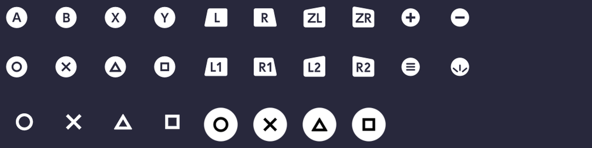
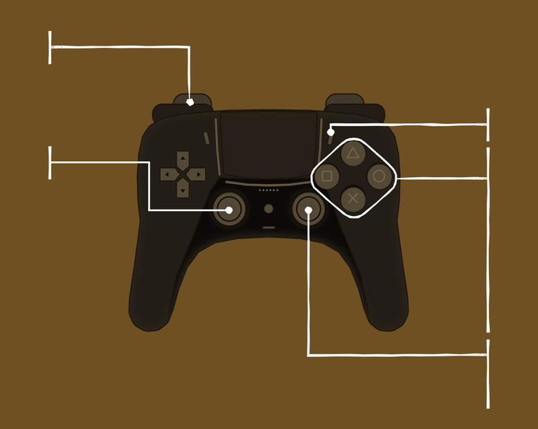

# PS Buttons pour Hookshot

Mod pour **The Legend of Zelda: Ocarina of Time** (remake Switch 2) joué sur PC avec **Hookshot** :
les icônes de boutons Nintendo sont remplacées par celles d'une **manette PlayStation**, dans le style graphique du jeu.

> 🇬🇧 *PlayStation button prompts for Ocarina of Time (Switch 2) on Hookshot. Download `ps-buttons-installer.exe` from
> Releases and double-click it: it builds the mod from your own game files and installs it. Requires game update 2.0.0.*



## Ce qui change

| Dans le jeu | Avant | Avec le mod |
|---|---|---|
| Invites à l'écran (« Ⓐ Parler », menus, textes) | Ⓐ Ⓑ Ⓧ Ⓨ | ○ ✕ △ □ |
| Gâchettes | L, R, ZL, ZR | L1, R1, L2, R2 |
| Boutons + et − | + / − | Options (☰) / Create |
| Notes d'ocarina | A, B, X, Y | ○, ✕, △, □ |
| Écran « Commandes » | manette Switch Pro | manette de style DualSense |

Les icônes gardent le style d'origine : mêmes pastilles et étiquettes, même épaisseur de trait que les lettres du jeu,
en blanc et noir.



## Installation (2 minutes)

> Il faut **Hookshot** déjà construit à partir de ta cartouche, avec le jeu en **mise à jour 2.0.0**.

1. Télécharge **`ps-buttons-installer.exe`** depuis la page [**Releases**](../../releases/latest).
2. **Double-clique dessus.** Tu peux le laisser dans Téléchargements, pas besoin de le déplacer.
   - Si Windows affiche « Windows a protégé votre ordinateur » : **Informations complémentaires**, puis
     **Exécuter quand même**. L'exe n'est pas signé, comme la plupart des outils de fans. Son code est dans ce dépôt.
   - Il trouve tout seul ton dossier Hookshot. S'il n'y arrive pas, il te demande de le choisir (le dossier qui
     contient `romfs` et `hookshot.exe`).
   - Il te demande ta disposition de manette : appuie simplement sur **Entrée** si tu n'as rien changé (voir plus bas).
3. Attends environ une minute : il fabrique le mod à partir de **ta** copie du jeu et l'installe dans
   `Hookshot\mods\PS_Buttons`.
4. Lance le jeu. C'est tout.

Pour vérifier que le mod est chargé : dans `Hookshot\hookshot_log.txt`, tu dois trouver `mods: PS_Buttons: 3 RomFS files`.

**Mettre à jour** : relance simplement l'installeur, il remplace l'ancienne version.
**Désinstaller** : supprime le dossier `Hookshot\mods\PS_Buttons`.
**Désactiver sans supprimer** : renomme-le `_PS_Buttons` (Hookshot ignore les dossiers qui commencent par `_` ou `-`).

> Tu avais installé une ancienne version en copiant un dossier `romfs` dans `mods` (par exemple
> `mods\ps_button-hookshot-main`) ? Supprime ce dossier : l'installeur te le signale s'il le trouve.

## Disposition de la manette : « Nintendo » ou « Xbox / PC »

Le mod place ○ sur le bouton de **droite** et ✕ sur le bouton du **bas**, comme sur une vraie manette PlayStation.
Le bouton qui valide dépend du réglage de Hookshot : **menu Hookshot → Controls → Layout preset**.

| Réglage Hookshot | Bouton qui valide | Réponse à l'installeur |
|---|---|---|
| **Nintendo** (par défaut) | ○ (droite) | **Entrée** |
| **Xbox / PC** ou **Swap Face** | ✕ (bas) | **X** puis Entrée |

Si tu changes de réglage plus tard, relance l'installeur et donne l'autre réponse : les icônes des invites suivront.
Le dessin de la manette de l'écran « Commandes » montre toujours la vraie position des symboles.

Pour ouvrir le menu Hookshot : **Insert** ou **F1** au clavier, ou le bouton **PS** (ou **Share + Options**) sur la manette.

## Pourquoi un installeur plutôt que des fichiers à copier ?

Le mod modifie 3 fichiers du jeu. Les publier tels quels reviendrait à redistribuer des fichiers de Nintendo.
L'installeur ne contient **que du code et des dessins originaux** : il lit **ta** copie du jeu, fabrique le mod sur ta
machine et l'installe. Rien n'est téléchargé, rien n'est envoyé sur Internet, et le jeu lui-même n'est jamais modifié :
Hookshot charge le mod par-dessus les fichiers d'origine.

Tout le code est dans ce dépôt, pour ceux qui veulent le relire.

## Comment ça marche

Hookshot charge tout dossier `mods\<nom>\romfs\…` par-dessus les fichiers du jeu. L'installeur y écrit 3 fichiers :

| Fichier | Contenu | Ce que le mod y change |
|---|---|---|
| `Font2/Scalable/External…bfotf.zs` | police d'icônes utilisée dans les textes et les invites | glyphes Ⓐ Ⓑ Ⓧ Ⓨ, L/R/ZL/ZR, + et − redessinés |
| `UI/Layout2Archive/Common…bntx.zs` | textures de l'interface | icônes de boutons des textes, notes d'ocarina, dessin et traits de l'écran « Commandes » |
| `System/Resource/ResourceSizeTable…rsizetable.zs` | table des tailles des fichiers du jeu | taille de la police agrandie (elle pèse 1 Ko de plus) |

Quelques détails techniques, pour les curieux et les moddeurs :

- **Police** : les polices `.bfotf` sont des polices OpenType chiffrées par un simple XOR (clé `a6 01 85 02`, après un
  en-tête de 8 octets). Les glyphes sont redessinés dans le même fichier, aux mêmes codes (E040–E04C).
- **Textures** : format BNTX de la Switch 2, avec le rangement de pixels de la Tegra X1 **dont les bits 5 et 6 de
  l'adresse sont échangés**. Les icônes sont en BC4 ou ASTC, réencodées au même format et à la même taille.
- **Table des tailles** : le jeu réserve la mémoire de chaque fichier d'après cette table. Comme la police grossit, son
  entrée est agrandie. Cette table est compressée en zstd **sans dictionnaire**, car le jeu la lit avant d'avoir chargé
  ses dictionnaires : la compresser avec un dictionnaire fait planter le jeu au démarrage.
- **Écran « Commandes »** : la manette dessinée est un dessin original inspiré de la DualSense, pas l'image officielle
  de Sony. Les traits qui relient les libellés aux boutons sont redessinés quand un bouton a changé de place
  (croix, stick gauche, Create, Options).

### Le code

| Fichier | Rôle |
|---|---|
| [`ps_buttons/__main__.py`](ps_buttons/__main__.py) | l'installeur : trouve le jeu, vérifie la version, fabrique et installe le mod |
| [`ps_buttons/locate.py`](ps_buttons/locate.py) | trouve le dossier Hookshot (réglages du builder Hookshot, dossier de l'exe, ou choix manuel) |
| [`ps_buttons/build.py`](ps_buttons/build.py) | fabrique les 3 fichiers : police, textures, table des tailles |
| [`ps_buttons/shapes.py`](ps_buttons/shapes.py) | les symboles ○ ✕ △ □ |
| [`ps_buttons/controller.py`](ps_buttons/controller.py), [`controller_draw.py`](ps_buttons/controller_draw.py) | la manette de l'écran « Commandes » et ses traits |
| [`ps_buttons/bntx.py`](ps_buttons/bntx.py), [`tex.py`](ps_buttons/tex.py) | lecture et écriture des textures Switch 2 |

Lancer depuis les sources (Python 3.12 ou plus) :

```bash
python -m venv .venv
.venv\Scripts\python -m pip install -r requirements.txt
.venv\Scripts\python -m ps_buttons                         # installe dans le dossier Hookshot trouvé
.venv\Scripts\python -m ps_buttons --game-dir "C:\chemin\vers\Hookshot" --xbox
```

Tests (ceux qui lisent le jeu ont besoin de `HOOKSHOT_DIR`) :

```bash
set HOOKSHOT_DIR=C:\chemin\vers\Hookshot
.venv\Scripts\python -m pytest
```

L'un d'eux vérifie que le mod fabriqué est identique à la version testée en jeu (à la date d'enregistrement de la
police près). Construire l'exe :
`.venv\Scripts\pyinstaller packaging\ps-buttons-installer.spec`.

## Limites connues

- Les icônes de joystick (L et R ronds de « Se déplacer » / « Caméra ») ne changent pas.
- Les notes L et R de l'ocarina gardent L et R.
- Le bouton PS de l'écran « Commandes » est un simple rond (pas de logo PlayStation).
- Seule la version « manette Pro » de l'écran « Commandes » est modifiée. Une manette PlayStation est vue comme une
  manette Pro, donc c'est celle que tu verras.

## Compatibilité avec d'autres mods

Un autre mod qui remplace l'un des 3 fichiers ci-dessus entrera en conflit avec celui-ci (celui chargé en dernier
l'emporte). C'est surtout le cas de la table des tailles, que beaucoup de mods modifient. Hookshot charge les mods par
ordre alphabétique : nomme les dossiers `01-…`, `02-…` pour choisir l'ordre.

## Crédits

Mod réalisé par **TELOS**.

*Projet de fan, non affilié à Nintendo ni à Sony. Il te faut ta propre copie du jeu.*
